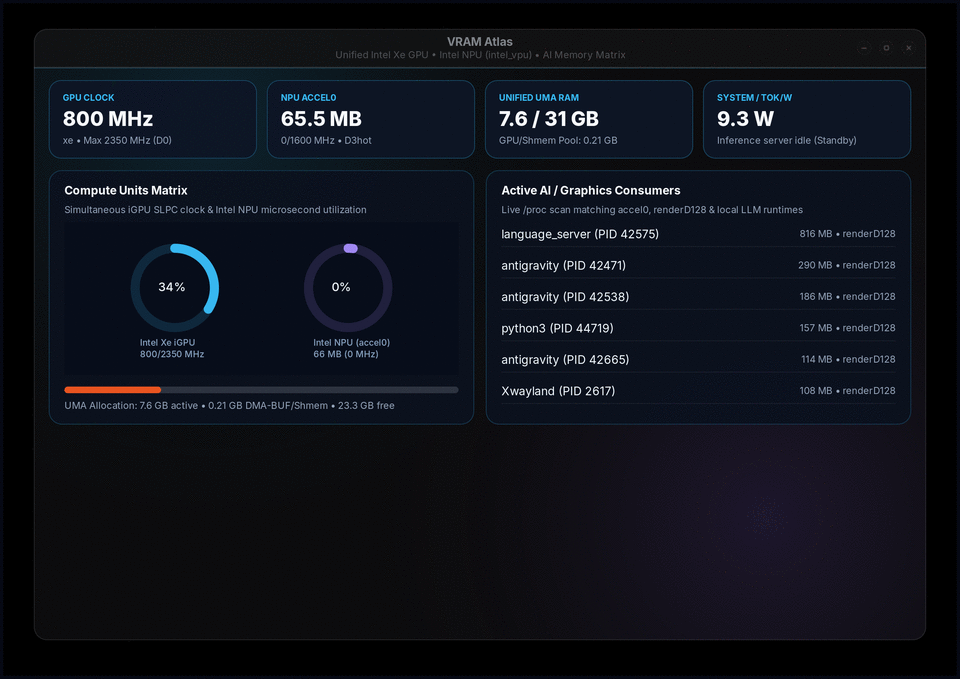
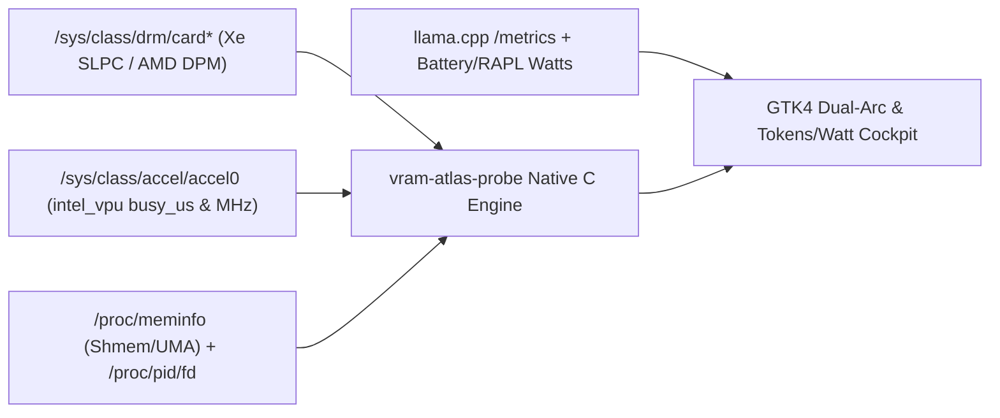
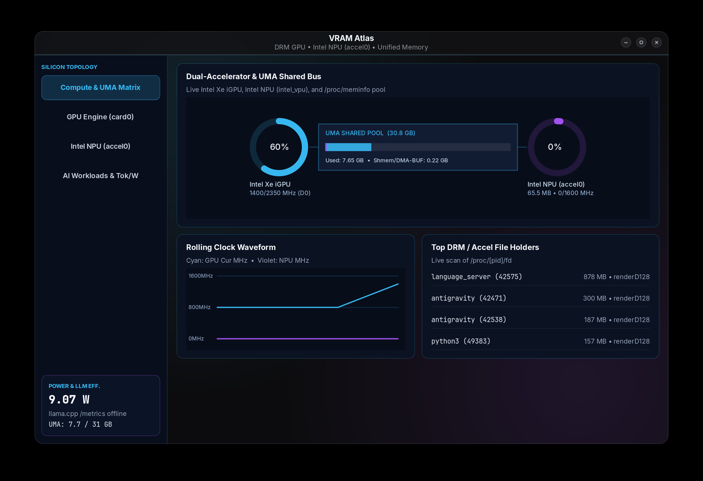

# VRAM Atlas

[](LICENSE)
[](#architecture)
[](#gallery)
[](https://github.com/lwrlock/ff-power-manager)

**Unified Linux AI & Graphics Accelerator Profiler for Intel Xe/Arc iGPU, Intel NPU (`intel_vpu accel0`), AMD Radeon, Unified Memory (UMA), and local LLM (`llama.cpp` / `ollama`) `Tokens / Watt` efficiency.**

<p align="center">
  
</p>

## Architecture



## Key Capabilities

- **Intel NPU (`accel0` / `intel_vpu`) Telemetry:** Reads `npu_busy_time_us`, current/max MHz (`1600 MHz`), D-state (`D0`/`D3hot`), and `npu_memory_utilization` directly from kernel `accel` sysfs.
- **Intel Xe SLPC & Radeon DPM Discovery:** Monitors live GPU `cur_freq`/`act_freq`/`rp0_freq`, active power profiles, and VRAM/GTT memory consumers.
- **UMA Shared Pool & AI Workload Watcher:** Tracks Linux `Shmem` DMA-BUF vs free RAM alongside active `/dev/accel/*` and `/dev/dri/render*` inference consumers.
- **Local LLM `Tokens / Watt` (`Tok/W`):** Pairs `llama.cpp` throughput metrics with live hardware power telemetry.

<details>
<summary><b>Full-Resolution UI Screenshot</b></summary>

<p align="center">
  
</p>

</details>

## Build & Run

```bash
make all && make test
./vram-atlas-probe --json
PYTHONPATH=src /usr/bin/python3 -m vram_atlas.gui
```

---

### FF Linux Kernel & Systems Suite
[FF Power Manager](https://github.com/lwrlock/ff-power-manager) · [eBPF Latency Guard](https://github.com/lwrlock/ebpf-latency-guard) · **VRAM Atlas** · [Waylens Privacy](https://github.com/lwrlock/waylens-privacy) · [MemPulse](https://github.com/lwrlock/mempulse) · [NetPulse BPF](https://github.com/lwrlock/netpulse-bpf) · [NVMe Sentinel](https://github.com/lwrlock/nvme-sentinel)

MIT License — Copyright (c) 2026 Furkan (**lwrlock**). Built with assistance from Google DeepMind Antigravity.
